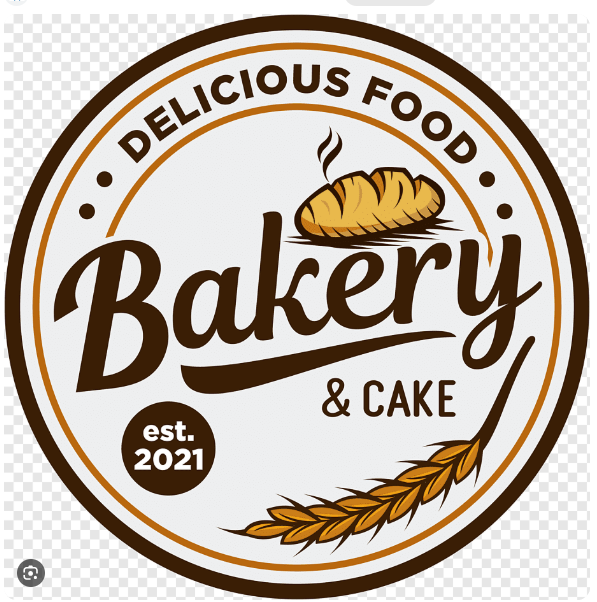

# Bakery & Cake: Sales Dashboard

A mobile-first sales dashboard for the owner and counter staff of Bakery & Cake. It shows revenue, orders, average order and items sold, a sales-by-hour chart, top sellers and category breakdown, with large buttons and icons and a palette taken from the logo.

Status: design spec only. No dashboard is implemented yet.

## Features

Specified in [spec.md](spec.md), none built yet:

- Period switch: Today, Week, Month
- Four KPI cards with change vs. the previous period
- Sales chart with previous-period line
- Top 5 sellers
- Category tiles that filter the whole view
- Export report and Share actions
- Loading, empty, error and offline states

## Files

| File | Purpose |
|------|---------|
| `spec.md` | Full dashboard specification |
| `practice.md` | Working rules for this repo |
| `assets/logo.png` | Supplied logo (needs a clean transparent version) |
