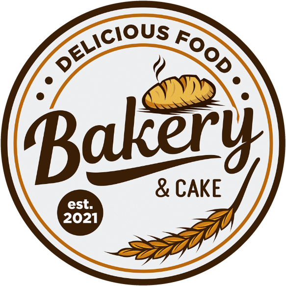

# Bakery & Cake: Sales Dashboard



A mobile-first sales dashboard for the owner and counter staff of Bakery & Cake. It shows revenue, orders, average order and items sold, a sales-by-hour chart, top sellers and a category breakdown, with large buttons and icons and a palette taken from the logo.

Live: https://e37dey.github.io/bakery-sales-dashboard/ (GitHub Pages, served from `main`)

Status: first version. It runs entirely on simulated demo data. No real POS or sales source is connected, and the page says so on screen.

## Run it

Plain HTML, CSS and JavaScript, no build step and no dependencies.

```bash
python -m http.server 8765
```

Then open http://127.0.0.1:8765. Add `?state=error`, `?state=empty` or `?state=offline` to preview those states.

## Features

Built in v1:

- Period switch: Today, Week, Month (remembered on the device)
- Four KPI cards with change vs. the previous period
- Sales chart with previous-period line, tap for details, and a table view
- Top 5 sellers
- Category tiles that filter the whole view
- Export report (browser print to PDF) and Share (native share sheet, or copy a text summary)
- Loading, empty, error and offline states
- Bottom navigation (Home only; Sales, Products and Reports show "Coming soon")

Not built yet, see [spec.md](spec.md): real data source, detail screens, dark mode, right-to-left language.

## Files

| File | Purpose |
|------|---------|
| `index.html` | Page structure |
| `styles.css` | Palette tokens and all styling |
| `app.js` | Rendering, chart, interactions |
| `data.js` | Demo data generator and the aggregate functions |
| `spec.md` | Full dashboard specification |
| `practice.md` | Working rules for this repo |
| `assets/logo.png` | Supplied logo (search-result screenshot) |
| `assets/logo-circle.png` | Logo cropped to a transparent circle, used in the page |
| `assets/favicon.png` | 64 px favicon from the same crop |
